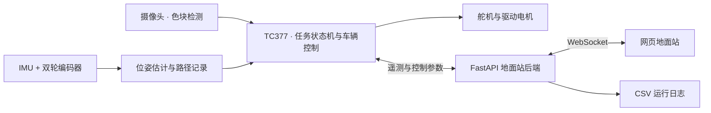

# 谭启帅 · 工程项目作品集

上海海事大学 · 电气工程及其自动化

## 卡丁快跑｜全国大学生智能汽车竞赛

**华东赛区一等奖 · 全国赛区一等奖**

这是一台能记录路线并自主返航的竞赛智能车。华东赛区用遥控完成去程，国赛改用视觉识别色块，跟随人员行驶至终点。**我负责 TC377 车端应用和 KartGCS 网页地面站的代码编写。**

### 实车演示

国赛阶段实车跑测片段。 [观看完整视频（约 41 秒）](projects/kart-racing/media/national-track.mp4)

### 系统架构

- **感知与定位**：摄像头识别人员身上的色块，为跟随提供目标位置。IMU 和双轮编码器用于估计车身航向与位置，为记录路线和返航提供输入。
- **车端控制**：TC377 基于逐飞库运行任务状态机，按 10 ms 周期更新。状态机管理遥控、视觉跟随和返航阶段，控制程序计算转向与车速并下发到执行机构。
- **地面站**：FastAPI 后端接收车辆遥测，通过 WebSocket 更新网页上的轨迹和运行状态。调试时在网页下发控制参数，并将实测数据导出为 CSV。

### 赛题与运行逻辑

| 阶段 | 车辆如何完成任务 |
| --- | --- |
| 华东赛区 · 科目一 | 先记录打点路径，再通过路径追踪复现路线。 |
| 华东赛区 · 科目二 | 接收语音指令并执行指定动作。 |
| 华东赛区 · 科目三 | 遥控从起点驶到终点，同时记录去程路线，再由车辆自主返回起点。 |
| 全国赛区 | 识别人员身上的色块，按设定距离跟随并同步记录车辆路线，到达终点后切换到自主返航。 |

**视觉跟随与返航。** 车端先判断色块检测是否稳定，再进入跟随状态。跟随中根据目标在画面中的位置调整转向，并依据目标距离调节车速。目标短时丢失时减速，持续丢失时停车。进入返航阶段后，按去程记录生成返航路径，结合当前位姿用 Pure Pursuit 计算转向。

### 地面站与实车调试

**调试案例 · 色块丢失后的响应。** 从实车日志中选取 84.7 秒、1,152 条连续记录，将跟随状态与左右轮实测速度放在同一时间轴上。调试时可对照「丢失减速」与「丢失停车」两个状态，检查车辆是否按预期降速和停下。

[样例 CSV](projects/kart-racing/data/follow-sample.csv) · [遥测字段说明](projects/kart-racing/data/README.md) · [地面站前端源码](projects/kart-racing/ground-station/index.html)

| 校赛现场 | 国赛现场 |
| --- | --- |
|  |  |

## 其他项目

| 项目 | 简介 |
| --- | --- |
| ESP32-S3 AI 语音对话手表 | 基于微雪触屏开发板，使用 LVGL 实现界面，串联 STT、DeepSeek 和 TTS 完成语音对话。 |
| 双视觉机械臂模仿学习抓取系统 | 使用外部与腕部双摄采集示教数据，训练 LeRobot ACT 策略，并在 SO-101 上验证自主抓取与投放。 |
