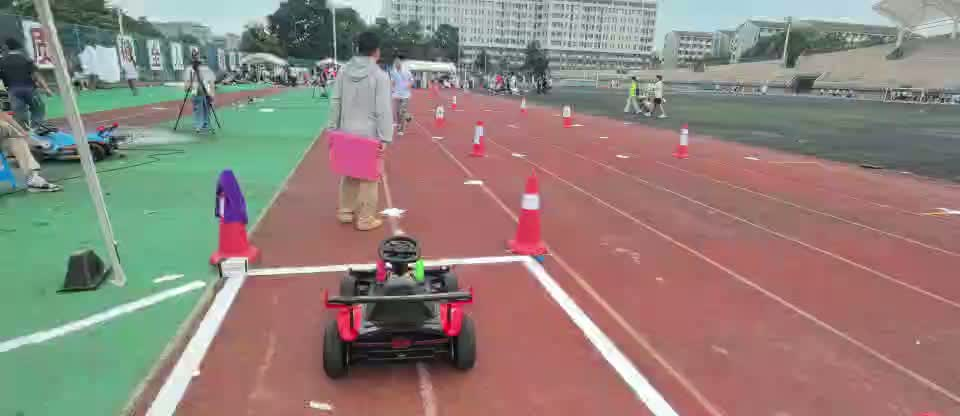

# 谭启帅 · 机器人与嵌入式项目集

**上海海事大学 · 电气工程及其自动化 · 2028 届**

智能车控制 ｜ 嵌入式交互 ｜ 机器人模仿学习

三个项目围绕传感器、控制、交互和真机验证展开。各项目页面介绍本人负责的工作、实现思路、代码结构及已有成果。

## 项目总览

- **[卡丁快跑](projects/01-kart-racing.md)** · 2025.09–2026.09 
  基于 TC377 与逐飞库，负责车端应用程序、网页地面站及实车联调，实现定位、路径追踪与视觉跟随。

- **[AI 语音对话手表](projects/02-ai-watch.md)** · 2026.03–2026.09 
  基于 ESP32-S3 与 LVGL，负责触屏界面及 STT → DeepSeek → TTS 语音交互流程。

- **[双视觉机械臂模仿学习抓取系统](projects/03-imitation-arm.md)** · 2026.09–2026.11 
  基于 SO-101、LeRobot 与 PyTorch，负责双摄示教采集、ACT 训练、网页控制台与真机部署。

## 项目成果

### 卡丁快跑

**华东赛区一等奖、全国赛一等奖。** 从华东赛区的惯导打点与路线复现，推进到国赛的视觉色块跟随、去程路径记录和倒车返航。配套网页地面站支持轨迹显示、参数下发与 CSV 导出。

[查看项目介绍与工程框架 →](projects/01-kart-racing.md)

### AI 语音对话手表

使用微雪 ESP32-S3 触屏开发板，完成 AI 语音对话界面与交互流程。录音经 STT 转为文本，交给 DeepSeek 根据提示词生成回复，再由 TTS 合成语音并通过 I²S 播放。

**项目成果：** 中国国际大学生创新大赛三等奖、“汇创青春”市级二等奖、“挑战杯”校内赛二等奖。

[查看实拍演示、交互流程与代码结构 →](projects/02-ai-watch.md)

### 双视觉机械臂模仿学习抓取系统

基于 SO-101 与外部、腕部双摄像头采集示教数据，使用 LeRobot 训练 ACT 策略并部署到真机，在目标位置完成自主抓取与投放。

**训练记录：** 一组示教数据包含 50 条片段、23,491 帧，已保存训练至 100,000 步的 ACT 检查点。

[查看真机演示、ACT 训练与部署流程 →](projects/03-imitation-arm.md)

## 技术与实现

| 方向 | 项目中的具体工作 |
| :-- | :-- |
| 车辆控制 | IMU 与双轮编码器定位、路径记录与追踪、视觉跟随状态机、100 Hz 控制 |
| 嵌入式交互 | LVGL 触控页面、录音与 WAV 缓冲、STT / 大模型 / TTS 接入、I²S 音频输出 |
| 机器人学习 | 双摄示教数据采集、ACT 策略训练、检查点加载与真机推理 |
| 调试工具 | 网页地面站、遥测 CSV、示教数据浏览 |

## 阅读与资料

本仓库用于展示三个项目的成果与实现思路，项目页面中的目录树对应原工程结构。各项目附有实拍视频、功能流程与模块说明。
