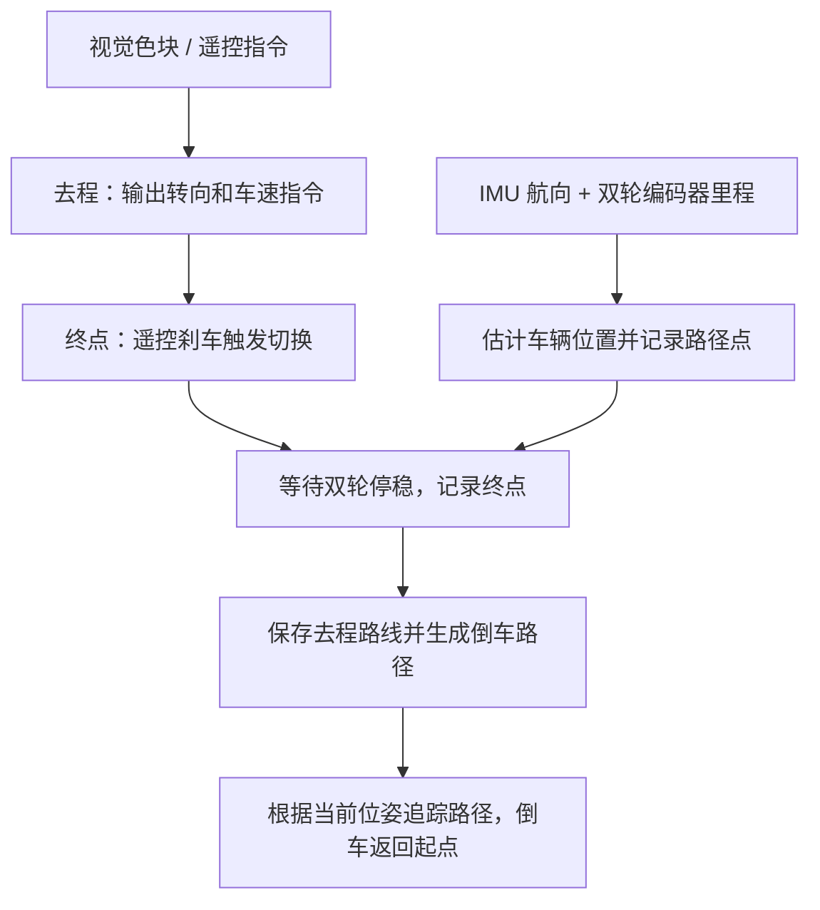
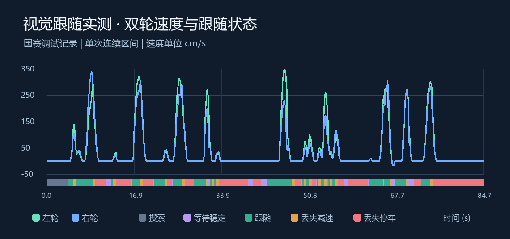

# 谭启帅 · 工程项目作品集

上海海事大学 · 电气工程及其自动化

## 卡丁快跑｜全国大学生智能汽车竞赛

**华东赛区一等奖 · 全国赛区一等奖**

国赛任务是让车跟随佩戴色块的人员到终点，记下去程路线，再沿记录的路线倒车返回起点。**我负责车端应用和 KartGCS 网页地面站的全部代码编写**，车端基于 AURIX TC377 与逐飞库。

### 实车演示

国赛阶段实车跑测。 [观看完整视频（约 41 秒）](projects/kart-racing/media/national-track.mp4)

### 去程如何变成返航路线

1. **去程控制。** 华东科目三由遥控器给出转向和车速。国赛改用摄像头识别色块，连续检测稳定后进入跟随。以色块相对车辆的方位调转向，用画面中色块的高度与设定值的偏差辅助调车速。两种模式共用车端控制接口。
2. **同步记录本车路线。** IMU 提供航向，双轮编码器提供里程和轮速。定位模块估计车辆位姿，地图模块保存路径点。收到刹车指令后，车辆仍在滑行的这一段也继续记录。
3. **终点切换与倒车返航。** 遥控刹车触发切换，状态机等待两侧轮速稳定，保存本次路线，再从终点向起点重建倒车路径。返航时用支持倒车方向的路径控制计算转向，根据当前位姿修正偏差。

华东赛另有两个科目：科目一先打点、再复现路径，科目二根据语音指令执行指定动作。

### 地面站怎么用于实车联调

车端把轨迹、跟随状态和轮速发给 **FastAPI 后端**，后端用 **WebSocket** 更新浏览器。调试时可以在网页下发控制参数，也可以将遥测记录导出为 CSV，回看状态切换与实际轮速是否一致。

**一次实测：色块丢失后，车辆什么时候停稳？** 样例日志在 **9.203 秒**处于丢失减速状态，两轮实测速度为 **174.2 / 193.1 cm/s**。在 **9.416 秒**切换到丢失停车状态，此时轮速仍为 **108.3 / 135.6 cm/s**，到 **10.118 秒**两轮实测速度均为零。

[样例 CSV](projects/kart-racing/data/follow-sample.csv) · [字段说明](projects/kart-racing/data/README.md) · [地面站前端源码](projects/kart-racing/ground-station/index.html)

### 车端模块

| 模块 | 职责 |
| --- | --- |
| `leader_vision.c` / `leader_follow.c` | 检测色块，判断目标有效性，生成跟随、减速或停车指令。 |
| `map.c` | 记录车辆路径点，为后续路径追踪提供参考。 |
| `state_machine.c` / `subject3.c` | 统一去程控制接口，处理终点状态切换、路线保存和返航路径生成。 |

### 比赛现场

| 校赛 | 国赛 |
| --- | --- |
|  |  |

## 其他项目

| 项目 | 简介 |
| --- | --- |
| ESP32-S3 AI 语音对话手表 | 基于微雪触屏开发板，使用 LVGL 实现界面，串联 STT、DeepSeek 和 TTS 完成语音对话。 |
| 双视觉机械臂模仿学习抓取系统 | 使用外部与腕部双摄采集示教数据，训练 LeRobot ACT 策略，并在 SO-101 上验证自主抓取与投放。 |
