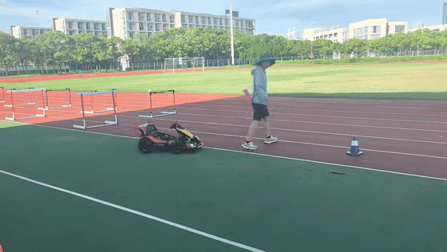
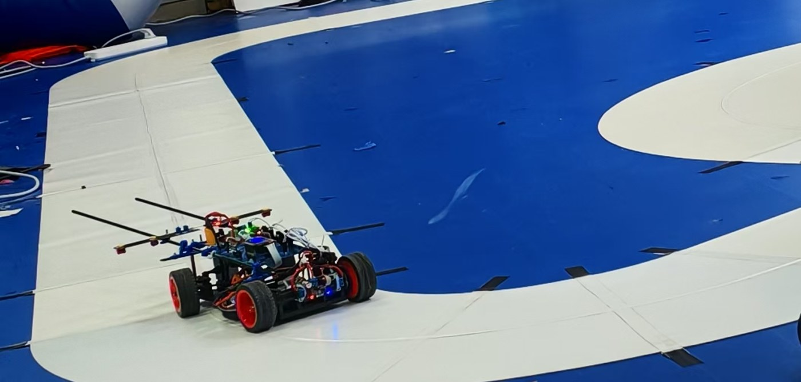

# 谭启帅 · 工程项目作品集

上海海事大学 · 电气工程及其自动化

## 卡丁快跑｜全国大学生智能汽车竞赛

**华东赛区一等奖 · 全国赛区一等奖**

负责车端控制程序和网页地面站开发。国赛实现视觉色块跟随、路径记录和自主返航。

[观看完整实车视频（约 41 秒）](projects/kart-racing/media/national-track.mp4)

| 校赛阶段 | 国赛阶段 |
| --- | --- |
|  |  |

华东赛区完成路径打点与复现、语音指令动作、遥控驶至终点后自主返航。全国赛区改为通过视觉识别人员身上的色块，跟随至终点并记录行驶路径，再自主返回起点。

### 个人负责

- **车端控制**：基于 TC377 和逐飞库编写控制程序，融合 IMU 与双轮编码器进行定位，通过追踪算法复现打点路径。国赛加入视觉跟随状态机，按设定距离跟随色块并同步记录路径。
- **网页地面站**：开发轨迹显示、控制参数下发、运行数据记录及 CSV 导出功能，用于实车测试和参数调试。

### 网页地面站

[查看地面站前端源码](projects/kart-racing/ground-station/index.html) · 实车连接和实时数据依赖本地 FastAPI 后端与 WebSocket。

### 遥测案例 · 色块丢失后的减速与停车

从实车日志截取约 **84.7 秒、1,152 条**连续记录，时间以该段首条记录为零点。上方两条曲线分别是左右轮实测速度，下方色带标记跟随状态。联调时可以把「丢失减速」「丢失停车」的切换与速度曲线对照，检查车端的响应。

[查看样例 CSV](projects/kart-racing/data/follow-sample.csv) · [字段说明](projects/kart-racing/data/README.md)

## 其他项目

| 项目 | 简介 |
| --- | --- |
| ESP32-S3 AI 语音对话手表 | 基于微雪触屏开发板，使用 LVGL 实现界面，串联 STT、DeepSeek 和 TTS 完成语音对话。 |
| 双视觉机械臂模仿学习抓取系统 | 使用外部与腕部双摄采集示教数据，训练 LeRobot ACT 策略，并在 SO-101 上验证自主抓取与投放。 |
