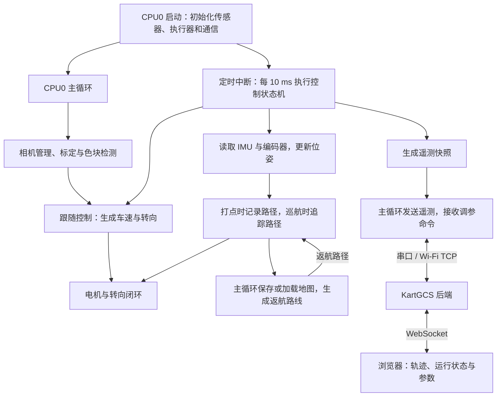
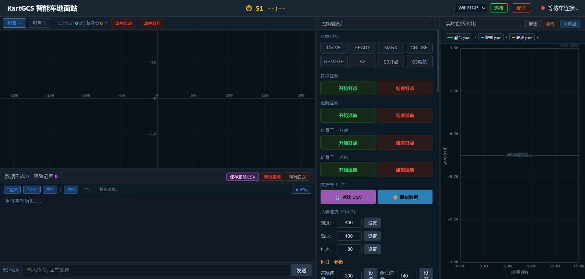

# 谭启帅 · 工程项目作品集

上海海事大学 · 电气工程及其自动化

## 卡丁快跑｜全国大学生智能汽车竞赛

**华东赛区一等奖 · 全国赛区一等奖**

**个人负责**　基于 AURIX TC377 与逐飞库编写车端应用，开发 KartGCS 网页地面站，并使用轨迹和遥测数据开展实车联调。

**国赛任务**　车辆识别人员身上的色块，跟随至终点并记录本车路线，随后按记录的路径倒车返回起点。

### 实车调试演示

[查看完整实车调试视频（约 41 秒）](projects/kart-racing/media/national-track.mp4)

### 工程结构

| 工程 | 主要目录和入口 |
| --- | --- |
| **TC377 车端固件** | `user/` 放启动入口和中断；`code/` 放车辆应用；`libraries/` 放英飞凌 iLLD 和逐飞驱动。ADS 工程配置在根目录，`Debug/` 为构建输出。 |
| **KartGCS 地面站** | 独立 Python 工程。 `server.py` 负责接入和消息分发，`protocol.py` 解析车端帧，`session_manager.py` 组织会话记录，`templates/index.html` 提供网页界面。 |

#### 车端模块

| 职责 | 源码 | 如何配合 |
| --- | --- | --- |
| 启动与调度 | `user/cpu0_main.c`、`user/isr.c` | CPU0 初始化外设和应用。定时中断每 10 ms 推进一次控制状态机；主循环处理图像服务、通信、地图保存与加载。CPU1、CPU2 保留入口框架。 |
| 任务调度 | `state_machine.c`、`subject1_map.c`、`subject2.c`、`subject3.c` | 状态机选择遥控、打点、巡航等分支。科目一管理打点地图，科目二接收语音命令并推进动作，科目三处理两种去程控制源、地图保存和返航。 |
| 定位与路线 | `imu.c`、`encoder.c`、`ins.c`、`map.c`、`fixed_task_map.c` | 用陀螺仪和双轮脉冲更新航向与位置，按运行阶段记录路径点。固定任务地图有独立的 Flash 保存与加载流程。 |
| 视觉跟随 | `camera_manager.c`、`camera_color_calib.c`、`leader_vision.c`、`leader_position.c`、`leader_follow.c` | 管理图像与色块标定，识别并估计目标位置，再把目标观测转换成车速、转向以及丢失后的减速或停车指令。 |
| 路径追踪与执行器 | `state_machine.c`、`pure_pursuit.c`、`motor.c`、`steer_motor.c`、`pid.c` | 巡航分支根据当前位置和参考路径计算控制量。支持正向 Pure Pursuit，倒车分支使用带行驶方向的路径控制。电机和转向模块执行控制。 |
| 回库视觉 | `garage_vision.c`、`garage_control.c` | 在科目三正向返航的相关阶段提供回库视觉辅助。 |
| 遥控、配置与遥测 | `remote_control.c`、`config.c`、`telemetry.c`、`uart.c`、`intercore_comm.c`、`screen.c`、`voltage.c` | 接收遥控输入，维护可调参数、遥测快照、地面站收发以及车载状态显示。 |

#### 运行时调用关系

#### 科目三怎样从去程切到返航

1. **去程。** 华东赛区科目三用遥控，国赛用视觉跟随。两种控制源都通过科目三的统一命令接口输出车速和转向；同时，惯导根据 IMU 和编码器更新本车位姿并记录路径点。
2. **终点。** 遥控刹车触发返航请求。状态机等待双轮实测速度稳定，补记终点，并把当前去程路线保存到 RAM。保存、加载和返航地图构建在主循环执行。
3. **返航。** 科目三模块以去程地图生成倒车路线，状态机进入巡航并根据当前位姿修正路径偏差。倒车分支把行驶方向传入路径控制，负责沿路线返回起点。

华东赛区另有科目一「打点与路径复现」以及科目二「语音指令动作」。

### 地面站与遥测案例

| 环节 | 源码与数据 |
| --- | --- |
| 采集与发送 | 车端 `telemetry.c` 生成快照，`uart.c` 发送路径点与遥测。路径点用 `P2` 表示，地图上下文用 `M2` 声明，视觉跟随记录使用 `LF` 帧。 |
| 接入与解析 | `server.py` 接入 TCP 或串口，`protocol.py` 按帧前缀解析字段。后端通过 WebSocket 更新浏览器，也接收由网页提交的控制和调参请求。 |
| 记录与导出 | `session_manager.py` 管理会话记录；后端另行缓存视觉跟随记录并导出 CSV，用于对照目标状态与实际轮速。 |

**一次实测：色块丢失后，车辆什么时候停稳？** 样例日志在 **9.203 秒**处于丢失减速状态，两轮实测速度为 **174.2 / 193.1 cm/s**。在 **9.416 秒**切换到丢失停车状态，此时轮速仍为 **108.3 / 135.6 cm/s**，到 **10.118 秒**两轮实测速度均为零。

[样例 CSV](projects/kart-racing/data/follow-sample.csv) · [字段说明](projects/kart-racing/data/README.md) · [地面站前端源码](projects/kart-racing/ground-station/index.html)

### 比赛现场

| 校赛 | 国赛 |
| --- | --- |
|  |  |

## 其他项目

| 项目 | 简介 |
| --- | --- |
| ESP32-S3 AI 语音对话手表 | 基于微雪触屏开发板，使用 LVGL 实现界面，串联 STT、DeepSeek 和 TTS 完成语音对话。 |
| 双视觉机械臂模仿学习抓取系统 | 使用外部与腕部双摄采集示教数据，训练 LeRobot ACT 策略，并在 SO-101 上验证自主抓取与投放。 |
