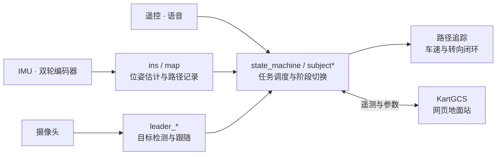
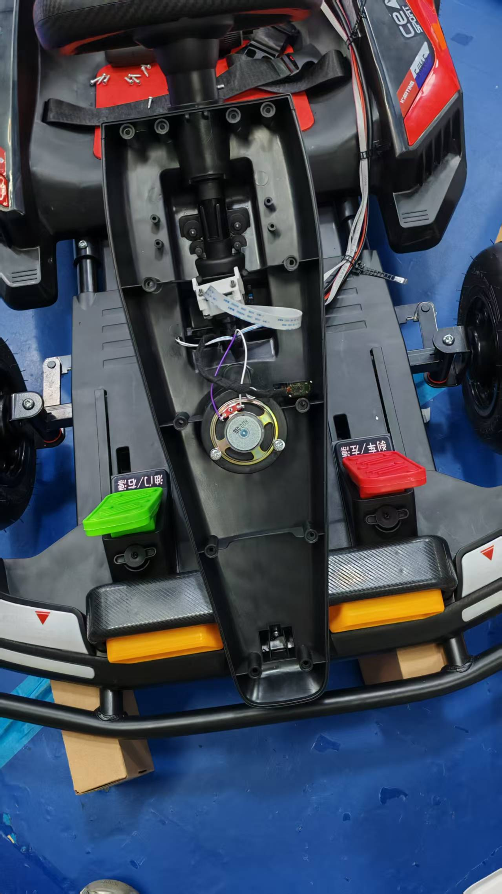
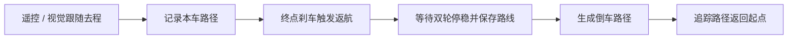
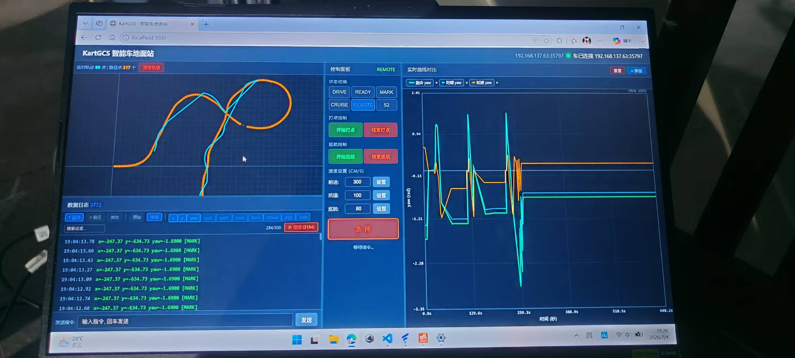

[← 返回项目集](../README.md)

# 卡丁快跑

**全国大学生智能汽车竞赛｜华东赛区一等奖、全国赛一等奖**

2025.09—2026.09　｜　AURIX TC377 · 逐飞库 · C · Python · FastAPI · WebSocket

[项目概述](#项目概述) · [比赛演示](#比赛演示) · [系统框架](#系统框架) · [主要职责与实现](#主要职责与实现) · [地面站与实测数据](#地面站与实测数据) · [代码结构](#代码结构)

## 项目概述

基于 AURIX TC377 和逐飞库开发竞赛智能车控制系统，结合 IMU、双轮编码器和视觉识别，实现打点路径复现、语音指令动作、视觉跟随与自主返航。配套开发 KartGCS 网页地面站，用于轨迹显示、参数下发和实测数据记录。

**个人负责**　智能车控制程序和网页地面站的全部代码编写，以及定位、跟随、返航等功能的实车联调。

<table><tr><td width="50%" align="center"><br><sub>TC377 控制器与外围接线</sub></td><td width="50%" align="center"><br><sub>项目展示现场</sub></td></tr></table>

## 比赛演示

### 全国赛区

以视觉识别人员身上的色块，控制车辆跟随到终点并同步记录去程路线，再自主返回起点。以下为带信标赛场的完整比赛视频。

https://github.com/user-attachments/assets/216b5492-6821-405f-9e5a-5105582cb5bc

[下载国赛视频 · 约 3 分 26 秒](kart-racing/media/national-competition.mp4)

### 华东赛区

华东赛区包含三个科目。科目一先打点再复现路线；科目二通过语音交互执行指定动作；科目三先遥控从起点行驶至终点，再自主返回起点。以下为华东赛区完整视频。

https://github.com/user-attachments/assets/12288ee7-8f96-4954-93e7-d39065050453

[下载华东赛区视频 · 约 1 分 50 秒](kart-racing/media/east-china-competition.mp4)

## 系统框架

车端围绕「输入与定位、任务调度、运动控制」组织功能，地面站负责状态展示与参数交互。当前应用运行在 CPU0，CPU1、CPU2 保留启动框架。



**调度方式**　`user/isr.c` 每 10 ms 调用 `state_machine_tick_10ms()`，执行定位更新、任务控制和执行器闭环。CPU0 主循环处理图像服务、地面站通信、地图保存与加载，科目三在主循环生成返航地图。

## 主要职责与实现

### 控制与定位

基于逐飞库完成 TC377 外设与控制程序集成。使用双轮编码器测量车轮脉冲，结合陀螺仪角速度更新车辆航向和位置；根据车辆位姿记录路径点，巡航时将当前位姿与参考路径进行比较，计算转向和车速。

正向追踪支持 Pure Pursuit；倒车返航进入带行驶方向的路径控制分支。电机模块和转向模块分别执行车速、转向闭环，公共调节参数集中在 `config.c`。

### 视觉跟随

国赛阶段加入色块检测、目标位置估计和跟随状态机。连续检测稳定后进入跟随，根据目标方位调整转向，并利用色块高度与设定值的偏差辅助调节车速。目标短时丢失时减速，持续丢失时停车，检测恢复后重新确认目标。

<table><tr><td width="50%" align="center"><br><sub>车载色块识别画面</sub></td><td width="50%" align="center"><br><sub>整车、摄像头与控制部件布局</sub></td></tr></table>

### 路径记录与返航

去程控制源可以选择遥控或视觉跟随，两者共用科目三控制接口。去程同步记录的是本车实际行驶轨迹，终点切换后用于生成返航路径。



收到返航请求后，状态机等待两轮实测速度稳定，并补记滑行与制动过程中的路径点；随后保存本轮路线到 RAM，加载路线并生成倒车路径，再进入返航巡航。

## 地面站与实测数据

### 轨迹、曲线与参数联调

基于 FastAPI 和 WebSocket 开发网页地面站。车端经串口或 Wi-Fi TCP 上报数据，后端解析后更新车辆轨迹、运行曲线和状态；网页可下发控制指令与参数，支持记录并导出 CSV。



<sub>实车运行画面，左侧显示轨迹，右侧对照运行曲线。</sub>


<sub>另一组调试记录，用于结合轨迹、曲线和参数观察车辆响应。</sub>

<details>
<summary>查看地面站完整界面布局</summary>


该截图为未连接设备时的界面布局，展示轨迹区、控制面板、日志区与曲线区。

</details>

### 遥测记录与数据分析

车端 `telemetry.c` 生成遥测快照，`uart.c` 发送运行数据；`protocol.py` 按前缀解析帧，`server.py` 分发消息与导出数据，`session_manager.py` 组织会话记录。路径点通过 `P2` 帧传输，地图上下文使用 `M2` 帧，视觉跟随记录使用 `LF` 帧。


<sub>原始导出表格截图，包含 S3_CRUISE 等状态及运行数据。下方分析图使用另一份视觉跟随日志样例。</sub>

**实测案例**　从视觉跟随日志中提取 84.7 秒、1,152 条连续记录，将状态切换与左右轮实测速度对齐。记录在 9.203 秒处于丢失减速状态，9.416 秒切换到丢失停车状态，10.118 秒两轮实测速度均为零，可据此观察控制状态与机械减速过程的对应关系。


[查看样例 CSV](kart-racing/data/follow-sample.csv) · [字段说明](kart-racing/data/README.md) · [地面站前端](kart-racing/ground-station/index.html)

## 代码结构

以下目录对应原始 TC377 固件与 KartGCS 工程。

```text
TC377 固件/
├── user/
│   ├── cpu0_main.c          # 外设初始化与主循环
│   ├── cpu1_main.c          # 核入口框架
│   ├── cpu2_main.c          # 核入口框架
│   └── isr.c                # 10 ms 控制中断
├── code/
│   ├── state_machine.c     # 总状态机、公共巡航与控制分支
│   ├── subject1_map.c      # 科目一路线管理
│   ├── subject2.c          # 语音命令动作调度
│   ├── subject3.c          # 去程模式、路线保存、返航地图
│   ├── imu.c / encoder.c / ins.c / map.c
│   ├── camera_manager.c / camera_color_calib.c
│   ├── leader_vision.c / leader_position.c / leader_follow.c
│   ├── pure_pursuit.c / motor.c / steer_motor.c / pid.c
│   ├── garage_vision.c / garage_control.c
│   ├── fixed_task_map.c    # 固定任务地图与 Flash 管理
│   └── config.c / remote_control.c / telemetry.c / uart.c
└── libraries/              # 英飞凌 iLLD 与逐飞驱动支持

KartGCS/
├── server.py               # 连接接入、消息分发与 CSV 导出
├── protocol.py             # 运行数据帧与路径点解析
├── session_manager.py      # 会话记录
├── templates/index.html    # 网页控制台
└── requirements.txt        # Python 依赖
```

| 模块 | 输入与职责 | 输出或调用关系 |
| :-- | :-- | :-- |
| `imu / encoder / ins` | 采集角速度与轮脉冲，更新本车位姿 | 供路径记录与巡航控制使用 |
| `camera_manager / leader_vision / leader_position` | 管理相机、检测色块、估计目标位置 | 提供给 `leader_follow` |
| `leader_follow` | 根据目标有效性与位置生成跟随命令 | 通过科目三统一接口参与车速和转向控制 |
| `map / subject3` | 记录去程、保存与加载路线、生成返航地图 | 供总状态机的巡航分支追踪 |
| `motor / steer_motor / pid` | 执行速度与转向闭环 | 控制驱动电机和转向执行器 |
| `telemetry / uart` | 生成遥测、上传路径与接收指令 | 与地面站协议解析和参数分发衔接 |

## 开发环境

车端采用 AURIX Development Studio 与 TASKING TriCore 工具链，使用 C 和逐飞库；地面站采用 Python、FastAPI、WebSocket 与浏览器前端。
