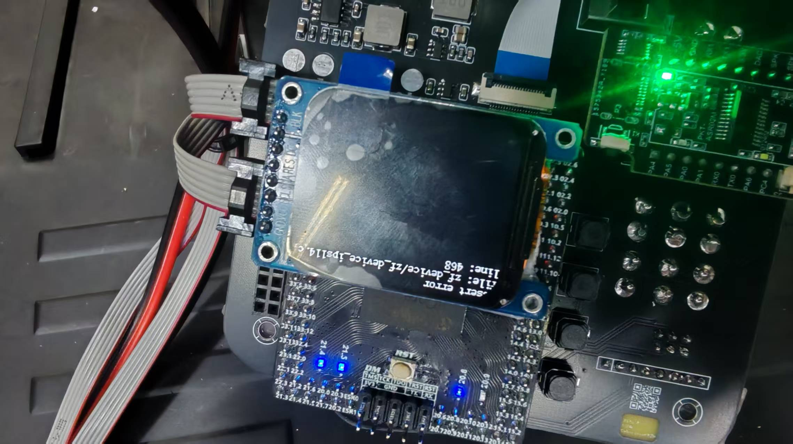
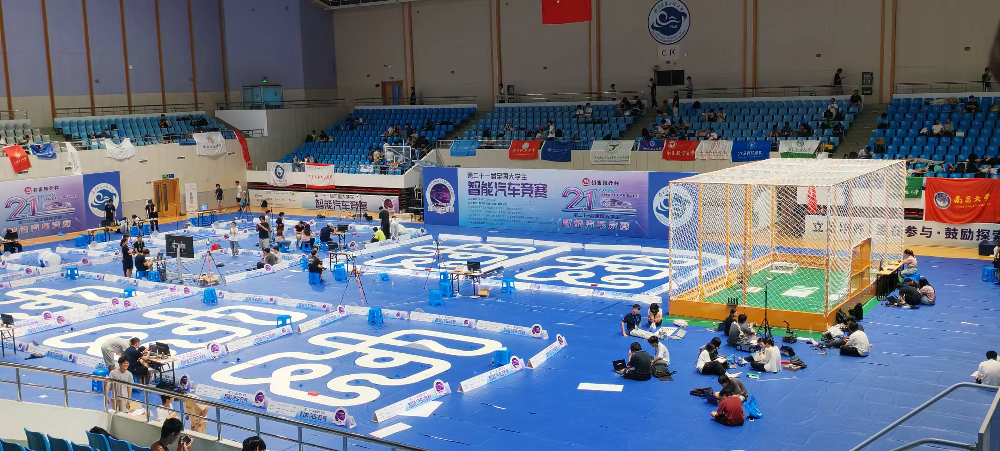
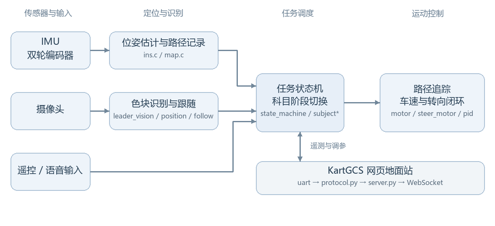
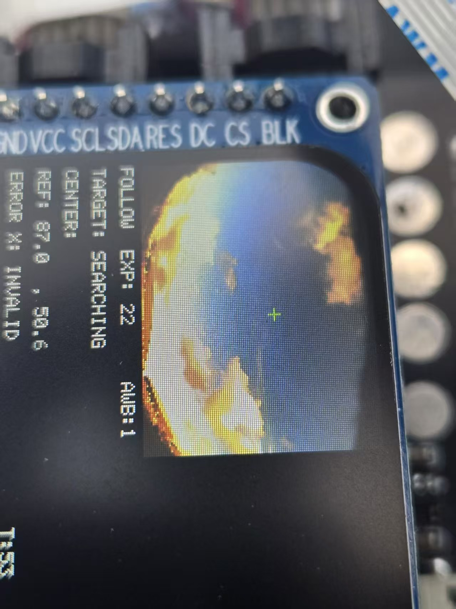
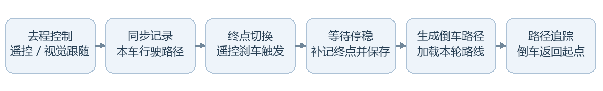
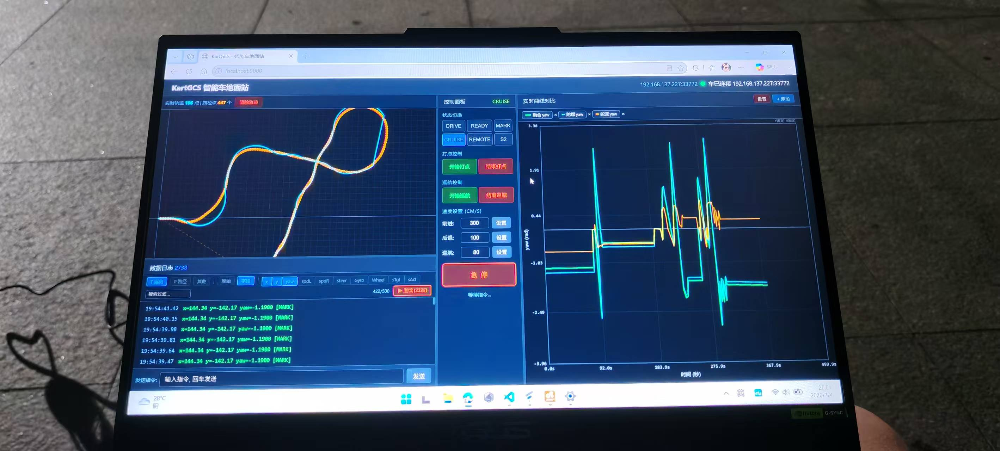
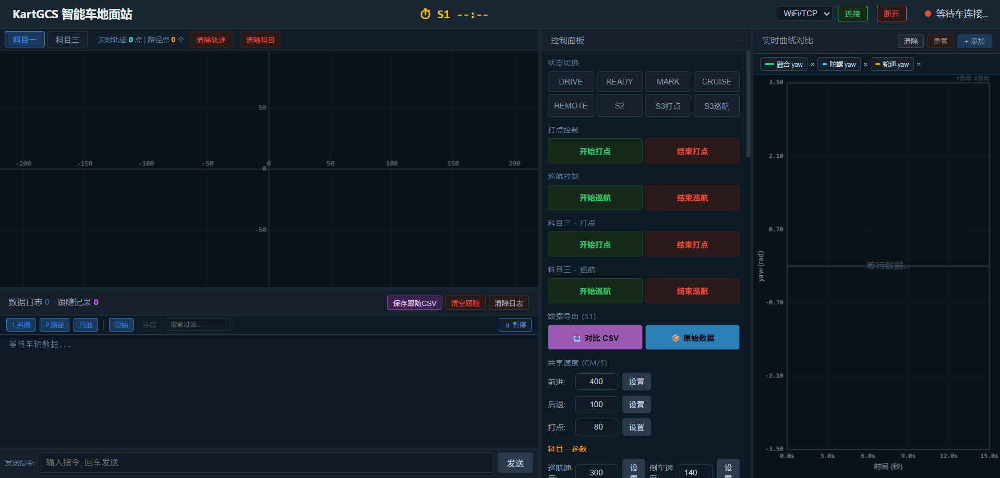
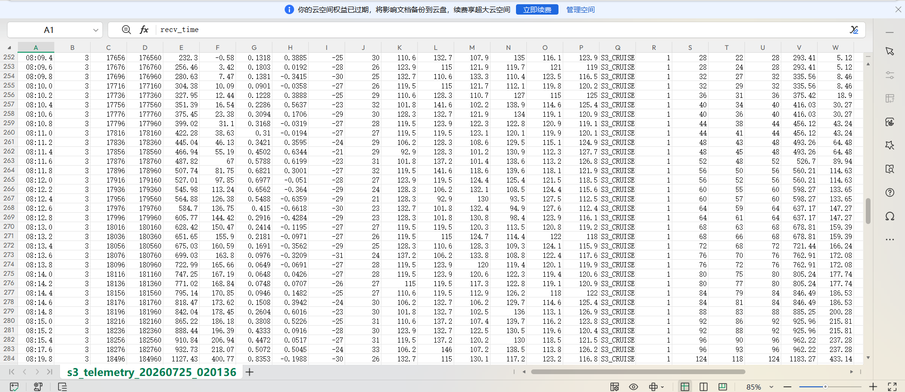
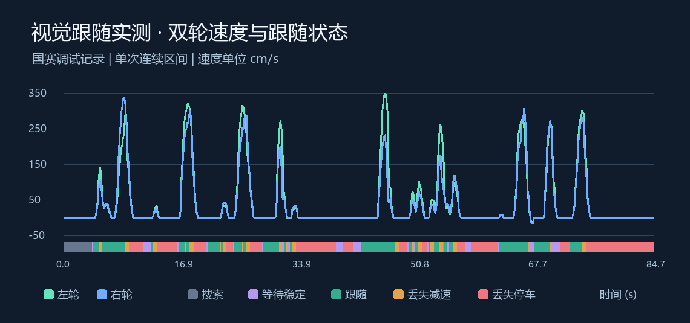

[← 返回项目集](../README.md)

# 卡丁快跑

**全国大学生智能汽车竞赛｜华东赛区一等奖、全国赛一等奖**

2025.09—2026.09　｜　AURIX TC377 · 逐飞库 · C · Python · FastAPI · WebSocket

[项目概述](#项目概述) · [比赛演示](#比赛演示) · [系统框架](#系统框架) · [功能与算法](#功能与算法对照) · [主要职责与实现](#主要职责与实现) · [地面站与实测数据](#地面站与实测数据) · [代码结构](#代码结构)

## 项目概述

基于 AURIX TC377 和逐飞库开发竞赛智能车控制系统，结合 IMU、双轮编码器和视觉识别，实现打点路径复现、语音指令动作、视觉跟随与自主返航。配套开发 KartGCS 网页地面站，用于轨迹显示、参数下发和实测数据记录。

**个人负责**　智能车控制程序和网页地面站的全部代码编写，以及定位、跟随、返航等功能的实车联调。

<table><tr><td width="50%" align="center"><br><sub>TC377 控制器与外围接线</sub></td><td width="50%" align="center"><br><sub>项目展示现场</sub></td></tr></table>

## 比赛演示

### 全国赛区

以视觉识别人员身上的色块，控制车辆跟随到终点并同步记录去程路线，再自主返回起点。以下为带信标赛场的完整比赛视频。

https://github.com/user-attachments/assets/216b5492-6821-405f-9e5a-5105582cb5bc

[下载国赛视频 · 约 3 分 26 秒](kart-racing/media/national-competition.mp4)

### 华东赛区

华东赛区包含三个科目。科目一先打点再复现路线；科目二通过语音交互执行指定动作；科目三先遥控从起点行驶至终点，再自主返回起点。以下为华东赛区完整视频。

https://github.com/user-attachments/assets/12288ee7-8f96-4954-93e7-d39065050453

[下载华东赛区视频 · 约 1 分 50 秒](kart-racing/media/east-china-competition.mp4)

## 系统框架

车端围绕「输入与定位、任务调度、运动控制」组织功能，地面站负责状态展示与参数交互。当前应用运行在 CPU0，CPU1、CPU2 保留启动框架。



**调度方式**　`user/isr.c` 每 10 ms 调用 `state_machine_tick_10ms()`，执行定位更新、任务控制和执行器闭环。CPU0 主循环处理图像服务、地面站通信、地图保存与加载，科目三在主循环生成返航地图。

### 代码运行方式

下表按当前本地工程的调用关系整理。

| 执行位置 | 主要调用 | 在系统中的作用 |
| :-- | :-- | :-- |
| CPU0 初始化 | 外设、传感器、状态机、相机和通信初始化 | 建立车辆控制所需的硬件与软件状态 |
| 10 ms 定时中断 | `state_machine_tick_10ms()` | 统一推进传感器采样、任务状态、定位与控制 |
| 中断内采样 | `imu_run_ahrs()`、`encoder_sample_10ms()` | 同一周期更新姿态数据与轮脉冲，供定位和控制复用 |
| CPU0 主循环 | 图像服务、命令处理、遥测发送、地图保存与加载 | 完成图像、通信与地图处理，并与控制中断交换数据 |

总状态机通过 `MARK / CRUISE` 管理科目一的打点与巡航，通过 `SUBJECT2` 管理语音动作，通过 `S3_MARK / S3_CRUISE` 管理科目三去程与返航；`DRIVE / READY / REMOTE` 等状态承担驾驶、准备和遥控切换。状态决定本周期由哪一路任务生成车速和转向目标。

## 功能与算法对照

| 实现的功能 | 当前工程采用的方法 | 主要代码 |
| :-- | :-- | :-- |
| 姿态与角速度处理 | 陀螺零偏标定、Mahony 互补滤波与四元数姿态更新 | `imu.c`、`AHRS/pose.c` |
| 车辆位置估计 | 双轮平均位移、陀螺航向增量、中点法积分 | `encoder.c`、`ins.c` |
| 打点与目标点选择 | 按位移间隔保存路径点，按前视距离选择追踪目标 | `map.c` |
| 正向路线复现 | Pure Pursuit，根据目标相对方位和前视距离计算曲率 | `pure_pursuit.c` |
| 正向综合控制及倒车返航 | 横向偏差修正、三点曲率前馈、航向 PD 与方向补偿 | `pure_pursuit.c`、`state_machine.c` |
| 色块检测与连续跟踪 | HSV 颜色相似度、种子扩展、连通域筛选、ROI 搜索与全图回退 | `leader_vision.c` |
| 跟随目标位置估计 | 色块高度—距离标定插值、像素方位换算与一阶滤波 | `leader_position.c` |
| 视觉跟随车速与转向 | 目标运动前馈、色块高度误差反馈、变化率阻尼及跟随状态机 | `leader_follow.c` |
| 双轮速度控制 | 一阶低通轮速、目标速度斜坡、增量式 PID | `encoder.c`、`motor.c`、`pid.c` |
| 转向执行器控制 | 绝对位置反馈与位置式 PID | `steer_motor.c`、`pid.c` |
| 语音指令动作 | 命令分发与定时状态机，控制灯光和雨刷动作 | `subject2.c` |

## 主要职责与实现

### 控制与定位

**姿态处理。** `imu_run_ahrs()` 每 10 ms 读取陀螺仪和加速度计，完成坐标映射、零偏处理与量纲转换，再调用 Mahony 姿态模块，得到后续定位使用的修正角速度。当前磁力计输入置零，磁航向修正关闭。

**航位推算。** `ins_update()` 将两轮原始脉冲换算成位移，取左右轮位移的均值作为车体位移增量；通过陀螺 Z 轴角速度积分得到航向增量，再用中点航向把位移投影到平面坐标。

```text
位移增量 = (左轮位移 + 右轮位移) / 2
中点航向 = 当前航向 + 航向增量 / 2
x += 位移增量 × cos(中点航向)
y += 位移增量 × sin(中点航向)
```

**路径记录。** `Map_RecordTask()` 根据当前位置到上次记录点的距离决定是否保存。当前普通路径点间隔为 10 cm，同时记录位置、航向和行驶方向；终点与方向切换使用专门的记录流程。

**采样分工。** 每周期统一读取一次编码器。原始轮脉冲送入航位推算，经过一阶低通的轮速送入电机 PID，使位移累加和速度闭环分别使用适合的数据。

### 路径追踪算法

**Pure Pursuit。** 正向追踪可以根据当前位姿与前方目标点，计算相对夹角 `alpha` 和前视距离 `Ld`，用 `kappa = 2 × sin(alpha) / Ld` 求出期望曲率，再换算为转向目标。`map.c` 提供前视目标点，`pure_pursuit_absolute()` 完成几何追踪。

**综合路径控制。** `cruise_path_control()` 以当前位置到路径线段的横向偏差修正期望航向，用路径附近三个点估计曲率并形成转向前馈，再由航向 PD 修正剩余航向误差。

```text
期望航向 = 路径切线方向 + 横向偏差修正
转向目标 = 曲率前馈 + 航向 PD 反馈
```

**倒车处理。** `state_machine.c` 根据行驶方向和控制模式分派算法。倒车固定进入综合路径控制，按倒车运动方向调整航向，并对前馈、反馈执行方向补偿；正向则可选择综合控制或 Pure Pursuit。

### 视觉识别与目标位置估计

**色块检测。** `leader_vision.c` 将 RGB565 像素转换为 HSV，根据标定颜色计算相似度，再通过种子扩展和连通域标记组织候选区域。结合面积、形状与匹配评分选取目标，输出中心位置、边界框、高度和置信度。

**连续跟踪。** 已锁定目标时，根据历史位置与尺寸设置 ROI 搜索区域，并检查新候选的位置、尺寸是否连续。局部搜索失败后回退到全图检测，以兼顾跟踪连续性和重新寻找目标。

**位置估计。** `leader_position_from_vision()` 对色块高度做一阶滤波，通过标定表的分段线性插值估算前向距离；标定参数也支持高度反比换算。图像水平位置经过像素—方位角标定得到目标方位，再结合相机安装偏移估算相对位置。

### 跟随策略与执行器控制

**跟随策略。** `leader_follow.c` 综合目标有效性、观测时效和连续检测次数，管理搜索、等待稳定、跟随、丢失减速和丢失停车等状态。目标稳定后，依据目标方位及变化趋势生成转向指令，并加入车辆偏航角速度阻尼。

**跟随车速。** 以目标运动速度估计作为前馈，叠加色块高度相对设定值的误差反馈，再加入高度变化率阻尼并限制输出速度，用于跟随距离调节和接近目标时的减速。

**速度闭环。** `motor_control()` 先对目标车速施加加减速斜坡，再用两侧滤波轮速分别执行增量式 PID，计算左右驱动 PWM。

**转向闭环。** 上层路径或跟随算法输出转向目标后，`steer_control()` 读取转向绝对位置，通过位置式 PID 生成转向电机输出。

<table><tr><td width="50%" align="center"><br><sub>车载色块识别画面</sub></td><td width="50%" align="center"><br><sub>整车、摄像头与控制部件布局</sub></td></tr></table>

### 路径记录与返航

去程控制源可以选择遥控或视觉跟随，两者共用科目三控制接口。去程同步记录的是本车实际行驶轨迹，终点切换后用于生成返航路径。



收到返航请求后，状态机等待两轮实测速度稳定，并补记滑行与制动过程中的路径点；随后保存本轮路线到 RAM，加载路线并生成倒车路径，再进入返航巡航。

### 语音指令动作

科目二由语音模块提供命令字，`subject2_dispatch()` 将命令映射为灯光与雨刷动作。灯光通过 GPIO 控制；雨刷以「向右、向左、回中」的定时状态推进，由 `subject2_tick_10ms()` 按周期更新。

## 地面站与实测数据

### 轨迹、曲线与参数联调

基于 FastAPI 和 WebSocket 开发网页地面站。车端经串口或 Wi-Fi TCP 上报数据，后端解析后更新车辆轨迹、运行曲线和状态；网页可下发控制指令与参数，支持记录并导出 CSV。


<sub>实车运行画面，左侧显示轨迹，右侧对照运行曲线。</sub>



<sub>另一组调试记录，用于结合轨迹、曲线和参数观察车辆响应。</sub>

<details>
<summary>查看地面站完整界面布局</summary>



该截图为未连接设备时的界面布局，展示轨迹区、控制面板、日志区与曲线区。

</details>

### 遥测记录与数据分析

车端 `telemetry.c` 生成遥测快照，`uart.c` 发送运行数据；`protocol.py` 按前缀解析帧，`server.py` 分发消息与导出数据，`session_manager.py` 组织会话记录。路径点通过 `P2` 帧传输，地图上下文使用 `M2` 帧，视觉跟随记录使用 `LF` 帧。



<sub>原始导出表格截图，包含 S3_CRUISE 等状态及运行数据。下方分析图使用另一份视觉跟随日志样例。</sub>

**实测案例**　从视觉跟随日志中提取 84.7 秒、1,152 条连续记录，将状态切换与左右轮实测速度对齐。记录在 9.203 秒处于丢失减速状态，9.416 秒切换到丢失停车状态，10.118 秒两轮实测速度均为零，可据此观察控制状态与机械减速过程的对应关系。



[查看样例 CSV](kart-racing/data/follow-sample.csv) · [字段说明](kart-racing/data/README.md) · [地面站前端](kart-racing/ground-station/index.html)

## 代码结构

以下目录对应原始 TC377 固件与 KartGCS 工程。

```text
TC377 固件/
├── user/
│   ├── cpu0_main.c          # 外设初始化与主循环
│   ├── cpu1_main.c          # 核入口框架
│   ├── cpu2_main.c          # 核入口框架
│   └── isr.c                # 10 ms 控制中断
├── code/
│   ├── state_machine.c     # 总状态机、公共巡航与控制分支
│   ├── subject1_map.c      # 科目一路线管理
│   ├── subject2.c          # 语音命令动作调度
│   ├── subject3.c          # 去程模式、路线保存、返航地图
│   ├── imu.c / encoder.c / ins.c / map.c
│   ├── camera_manager.c / camera_color_calib.c
│   ├── leader_vision.c / leader_position.c / leader_follow.c
│   ├── pure_pursuit.c / motor.c / steer_motor.c / pid.c
│   ├── garage_vision.c / garage_control.c
│   ├── fixed_task_map.c    # 固定任务地图与 Flash 管理
│   └── config.c / remote_control.c / telemetry.c / uart.c
└── libraries/              # 英飞凌 iLLD 与逐飞驱动支持

KartGCS/
├── server.py               # 连接接入、消息分发与 CSV 导出
├── protocol.py             # 运行数据帧与路径点解析
├── session_manager.py      # 会话记录
├── templates/index.html    # 网页控制台
└── requirements.txt        # Python 依赖
```

| 模块 | 输入与职责 | 输出或调用关系 |
| :-- | :-- | :-- |
| `imu / encoder / ins` | 采集角速度与轮脉冲，更新本车位姿 | 供路径记录与巡航控制使用 |
| `camera_manager / leader_vision / leader_position` | 管理相机、检测色块、估计目标位置 | 提供给 `leader_follow` |
| `leader_follow` | 根据目标有效性与位置生成跟随命令 | 通过科目三统一接口参与车速和转向控制 |
| `map / subject3` | 记录去程、保存与加载路线、生成返航地图 | 供总状态机的巡航分支追踪 |
| `motor / steer_motor / pid` | 执行速度与转向闭环 | 控制驱动电机和转向执行器 |
| `telemetry / uart` | 生成遥测、上传路径与接收指令 | 与地面站协议解析和参数分发衔接 |

## 开发环境

车端采用 AURIX Development Studio 与 TASKING TriCore 工具链，使用 C 和逐飞库；地面站采用 Python、FastAPI、WebSocket 与浏览器前端。
