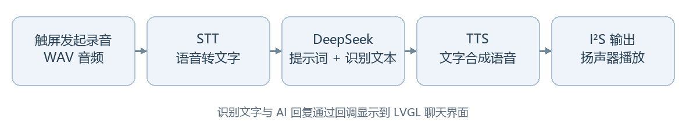
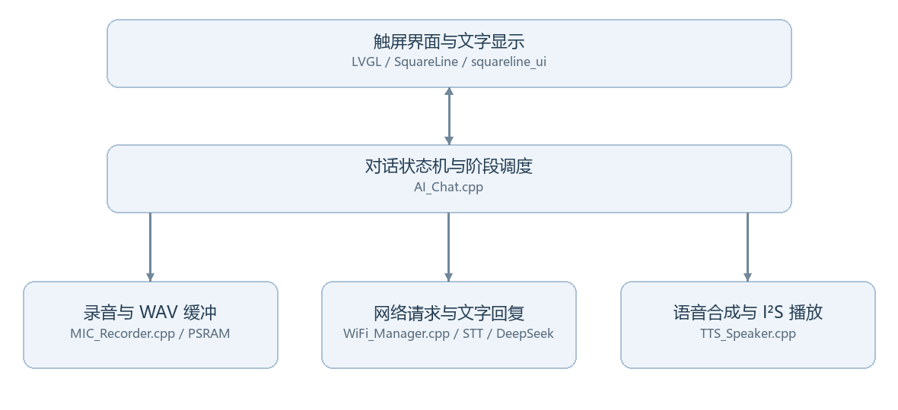
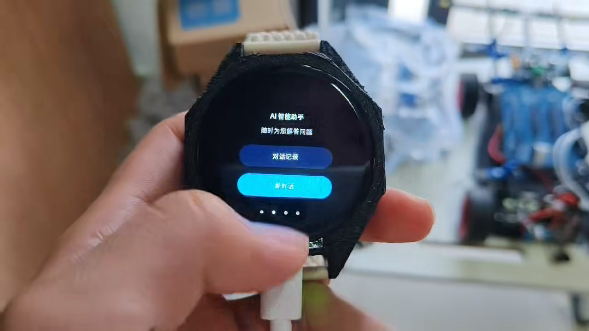
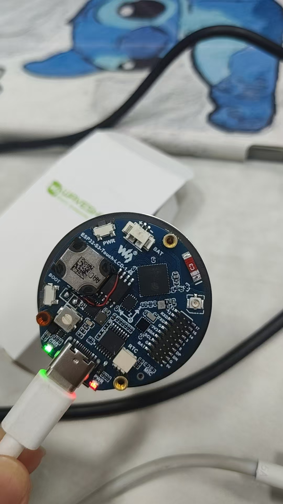

[← 返回项目集](../README.md)

# ESP32-S3 AI 语音对话手表

**中国国际大学生创新大赛三等奖｜“汇创青春”市级二等奖｜“挑战杯”校内赛二等奖**

2026.03—2026.09　｜　ESP32-S3 · C/C++ · LVGL · SquareLine Studio · DeepSeek · I²S

[项目概述](#项目概述) · [实物演示](#实物演示) · [完整交互流程](#完整交互流程) · [软件架构](#软件架构) · [个人工作与实现思路](#个人工作与实现思路) · [代码结构](#代码结构)

**个人负责：** 手表端触屏界面与语音交互功能开发。

## 项目概述

使用微雪 ESP32-S3 触屏开发板搭建手表原型，让用户通过触屏启动录音，在屏幕上查看识别文字和 AI 回复，并听到语音播报。界面使用 LVGL 与 SquareLine Studio，语音通过 STT、DeepSeek 和 TTS 三个接口串联。

## 实物演示

以下为手表实物与触屏界面演示，完整时长约 24 秒；约 10–16 秒展示 AI 助手入口与相关界面操作。

https://github.com/user-attachments/assets/01f67a89-3718-4604-8d73-f24d3897cc7d

[下载完整演示视频](ai-watch/media/watch-demo.mp4)

## 完整交互流程



### 从语音到回复

1. **采集。** 由录音模块读取麦克风数据，采用 16 kHz、16 bit 单声道格式并组织 WAV 缓冲，交给 STT 接口。
2. **生成。** 把识别结果作为用户消息，与系统提示词一并发给 DeepSeek。工程里的提示词要求使用简洁中文，并限制回复篇幅，便于手表显示和朗读。
3. **呈现。** 回调更新聊天气泡，将模型返回的文字提交给 TTS，合成后的音频经 I²S 输出。

## 软件架构



### 运行入口与状态机

`main.cpp` 依次初始化外设、显示、LVGL、界面、网络以及录音和对话模块。主循环调用 `Lvgl_Loop()` 和 `AI_Chat_Loop()`；独立的 `Driver_Loop` 任务处理电源键、时钟、电池等外设。

对话状态按 `IDLE → RECORDING → STT_WAITING → AI_WAITING → TTS → DONE → IDLE` 推进。录音阶段更新采样，识别和生成阶段执行网络请求，播报阶段调用 `TTS_Update()`，播报完成后回到待机。

## 功能与实现方法

| 功能 | 实现方法 | 对应代码 |
| :-- | :-- | :-- |
| 触屏交互 | LVGL 对象与触摸事件、AI 对话入口、文字与状态回调 | `squareline_ui/`、`LVGL_Driver.cpp` |
| 音频采集 | 16 kHz、16 bit 单声道采样与 WAV 缓冲 | `MIC_Recorder.cpp` |
| 对话生成 | STT 识别，提示词与识别文字交给 DeepSeek | `AI_Chat.cpp` |
| 播报控制 | TTS 音频获取、分阶段更新、I²S 输出 | `TTS_Speaker.cpp` |
| 阶段管理 | 对话状态枚举、状态反馈、录音与播放超时处理 | `AI_Chat.cpp`、`TTS_Speaker.cpp` |
| 资源与显示 | PSRAM 存储录音，中文字体加载 | `MIC_Recorder.cpp`、`ui_FontLoader.cpp` |

## 个人工作与实现思路

### 触屏交互

使用 LVGL 和 SquareLine Studio 编写 AI 对话入口、录音状态与文字回复显示逻辑。页面代码集中在 `squareline_ui/`，AI 对话界面通过回调接收识别文字、AI 回复和运行状态。中文显示由字体资源和 `ui_FontLoader.cpp` 配合。

<p align="center"></p>

<p align="center"><sub>AI 语音助手入口 · 原视频 10.8 秒抽帧</sub></p>

### 对话流程管理

一次对话会依次占用麦克风、网络和音频输出。将每个阶段放进对话状态机，根据识别结果、请求结果和播报状态决定下一步；请求或录音失败时给出状态反馈并退出当前流程。录音设置最大时长，TTS 的连接、响应头、音频下载和播放阶段分别处理超时。

### 录音缓冲与音频输出

录音数据由 `MIC_Recorder.cpp` 分配到 PSRAM。云端返回文字后，`TTS_Speaker.cpp` 负责获取合成音频并推进 I²S 播放，让文本生成和音频输出形成完整交互。

## 代码结构

```text
watch/
├── platformio.ini          # PlatformIO 与 Arduino 构建配置
├── lv_conf.h               # LVGL 配置
├── sdkconfig.defaults      # 底层配置
├── include/                # 模块头文件
└── src/
    ├── main.cpp            # 初始化、主循环和外设任务
    ├── AI_Chat.cpp         # 对话状态机、STT 和 DeepSeek 请求
    ├── MIC_Recorder.cpp    # 麦克风采样与 WAV 缓冲
    ├── TTS_Speaker.cpp     # TTS 获取、超时和 I²S 播放
    ├── WiFi_Manager.cpp    # 网络连接和 HTTP 请求封装
    ├── Emotion_Manager.cpp # 情绪分析
    ├── LVGL_Driver.cpp     # LVGL 显示与触摸桥接
    ├── Display_SPD2010.cpp / Touch_SPD2010.cpp
    ├── ui_FontLoader.cpp   # 中文字体加载
    └── squareline_ui/
        ├── ui.c / ui.h     # UI 初始化及对象声明
        ├── screens/        # 页面定义
        ├── fonts/          # 字体
        └── images/         # 图片资源
```

上述目录列出界面及语音对话的主要模块，原工程还包括电池、RTC、陀螺仪等外设模块。

## 硬件与开发环境

<p align="center"></p>

<p align="center"><sub>微雪 ESP32-S3 触屏开发板</sub></p>


| 项目 | 实现 |
| :-- | :-- |
| 硬件 | 微雪 ESP32-S3 触屏开发板 |
| 开发 | C/C++、PlatformIO、Arduino |
| 交互 | LVGL、SquareLine Studio、AI 对话入口与状态显示 |
| 语音 | 16 kHz 录音、STT、DeepSeek、TTS、I²S |
| 缓冲 | PSRAM 录音缓冲 |

已完成触屏界面开发与 AI 语音对话功能联调。
