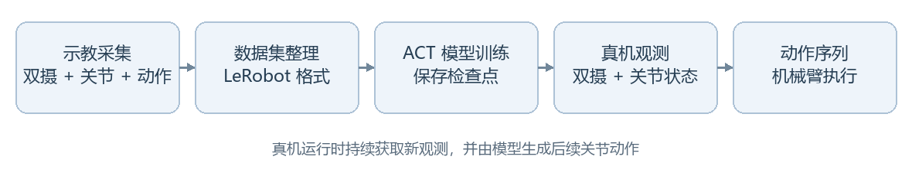
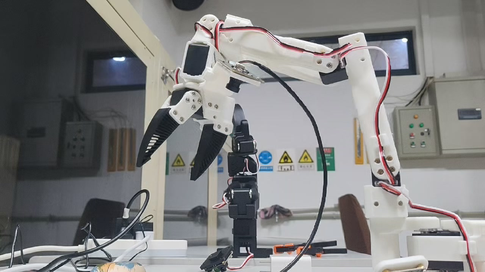
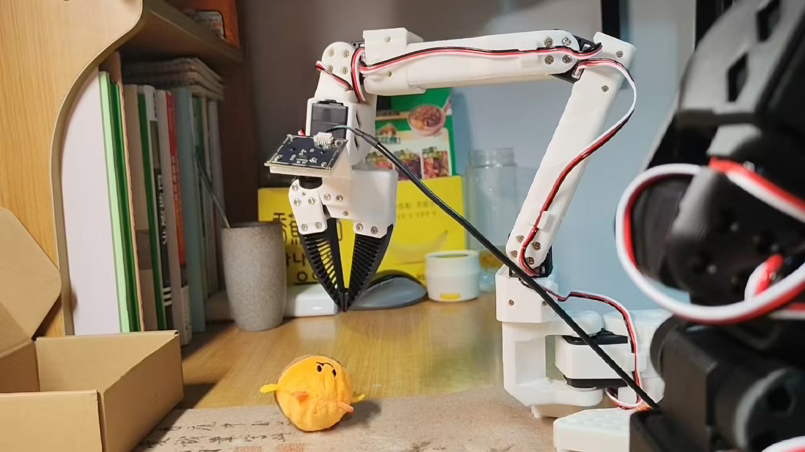
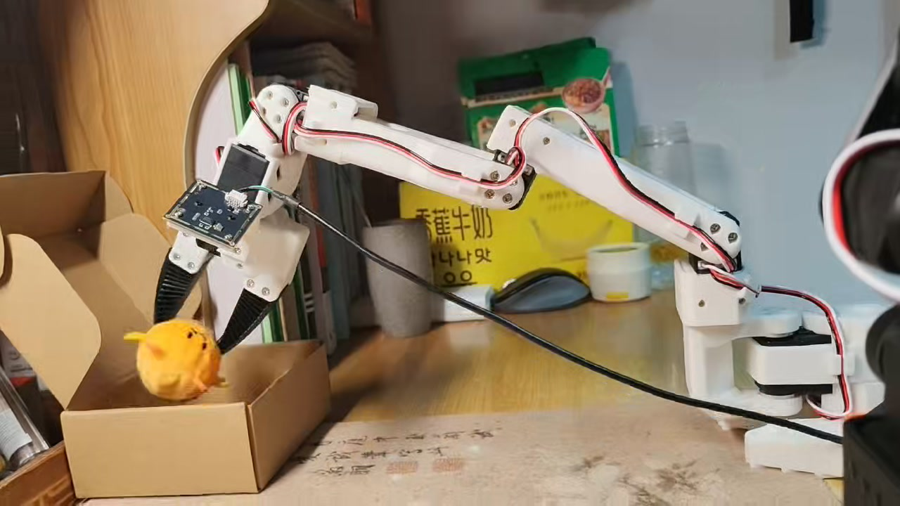
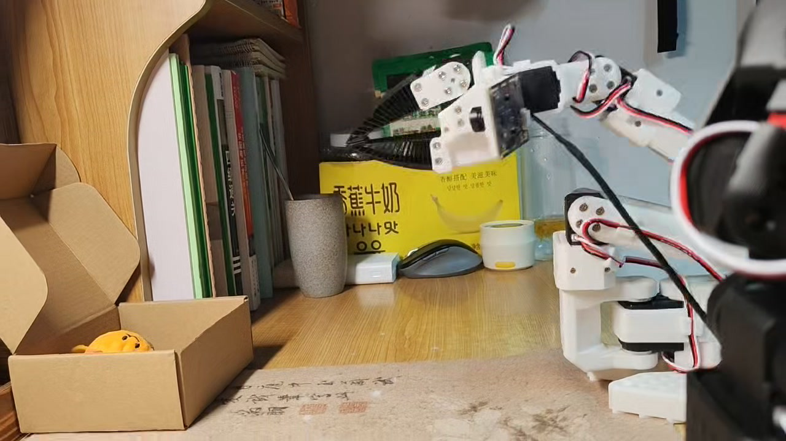
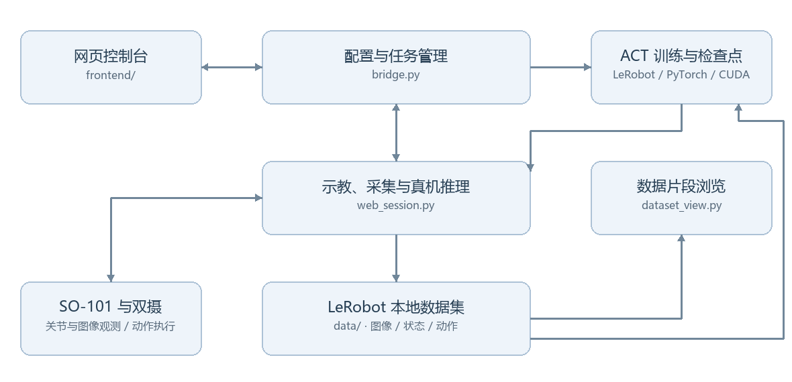

[← 返回项目集](../README.md)

# 双视觉机械臂模仿学习抓取系统

**项目成果｜在目标位置完成真机自主抓取与投放**

2026.09—2026.11　｜　SO-101 · Python · PyTorch · LeRobot · ACT · OpenCV

[项目概述](#项目概述) · [真机演示](#真机演示) · [从示教到部署](#从示教到部署) · [软件架构](#软件架构) · [工程优化](#工程优化) · [代码结构](#代码结构)

**个人工作**　ACT 模型训练与真机部署、网页控制台与示教采集流程集成。

## 项目概述

使用 SO-101 机械臂、外部相机与腕部相机，先人工示教抓取与投放动作，再用示教数据训练 ACT 策略。部署时，模型根据双路图像和当前关节状态预测后续关节动作，由机械臂执行。网页控制台把设备连接、数据采集、模型训练和真机运行串成一个本地工作流程。

## 真机演示

### 抓取与投放

视频展示目标摆放、机械臂接近、夹取并放入盒中的过程，完整时长约 17 秒。

https://github.com/user-attachments/assets/9957ae4c-4da3-4374-9683-9ae651e50bf4

[下载抓取与投放视频](imitation-arm/media/pick-and-place.mp4)

### 另一组真机运行画面

视频展示另一组机械臂动作与相机安装布局，完整时长约 32 秒。

https://github.com/user-attachments/assets/bdc8eb5a-3314-462d-94f1-2368524f623d

[下载真机运行视频](imitation-arm/media/arm-motion.mp4)

## 从示教到部署



### 示教与数据



<sub>取自第二段真机运行视频 2.0 秒，可观察机械臂、夹爪与相机布局。</sub>


通过 SO-101 主从机械臂或 X05 手柄控制从臂。外部相机观察工作区，腕部相机观察夹爪附近；采集时同时记录两路图像、六维关节状态和对应动作。六个控制量分别为底座、大臂、小臂、腕部俯仰、腕部旋转和夹爪。

录制使用 LeRobot 的数据集与录制流程。保存后可以浏览双路图像，逐帧检查状态与动作，检查视频和动作帧数是否一致。

### ACT 模型训练

在网页选择本地数据集并配置训练步数、批量大小，由 `bridge.py` 组织 LeRobot 的 ACT 训练参数，使用 CUDA 执行训练，日志回传网页。训练结果保存为模型检查点，供运行页面加载。

| 内容 | 训练与推理中的作用 |
| :-- | :-- |
| 外部和腕部图像 | 提供工作区与近距离抓取观测 |
| 六维关节状态 | 表示机械臂当前姿态和夹爪状态 |
| 示教动作 | 训练时的监督目标 |
| 动作序列 | ACT 根据当前观测预测后续关节目标 |

### 真机部署

选择训练输出中的 `pretrained_model` 目录，加载策略配置，并保持运行时的相机名称和观测配置与采集数据一致。`web_session.py` 接入 LeRobot 的 rollout 上下文与执行策略，将真实图像、关节观测交给模型，再把预测动作发送给 SO-101。完成抓取与投放后，可继续补充示教数据并重新训练。

模型训练与推理复用 LeRobot 的 ACT 实现，项目工作集中在设备接入、数据流程、训练配置与真机执行集成。

<table><tr>
<td width="33%" align="center"><br><sub>接近目标 · 抓取视频 6.0 秒</sub></td>
<td width="33%" align="center"><br><sub>夹持转移 · 抓取视频 10.8 秒</sub></td>
<td width="33%" align="center"><br><sub>放入盒中 · 抓取视频 14.0 秒</sub></td>
</tr></table>

<sub>以上为同一段抓取视频的原始抽帧。</sub>

## 软件架构



Windows 侧负责网页入口和 USB 接入，机器人学习运行环境位于 WSL2。控制台按「设备与遥控、示教与数据、模型训练、模型运行」组织功能，使采集数据和模型检查点能够在同一工作流中使用。

## 功能与方法

| 功能 | 使用方法 | 工程对应 |
| :-- | :-- | :-- |
| 主从示教 | 读取主臂关节动作，映射到从臂 | `web_session.py`、LeRobot SO-101 适配 |
| 手柄示教 | X05 输入接入遥操作适配器，复用 LeRobot FK/IK 处理末端控制 | `web_session.py` |
| 数据采集 | 双路图像、六维关节状态和动作同步进入 LeRobot 数据集 | `web_session.py`、`dataset_view.py` |
| ACT 训练 | 用示教动作监督策略，根据图像和关节状态学习后续动作序列 | `bridge.py`、LeRobot ACT |
| 真机推理 | 加载检查点，接入观测处理与 rollout 执行流程 | `web_session.py` |
| 保存优化 | 流式视频编码、设备会话复用与视频动作帧数检查 | `web_session.py` |

## 工程优化

### 双摄录制保存

**问题。** 一条示教结束后，从临时图像集中编码视频会增加等待时间，多条录制还会重复准备设备。

**处理。** 启用 LeRobot 流式编码，在采集过程中推进视频编码；下一条录制复用已连接的设备会话。结束时检查编码状态，并核对双路视频与动作帧数。

**离线结果。** 在双路 640×480、30 Hz、10 秒片段的对比中，`save_episode()` 调用耗时由 **22.60 秒降至 0.77 秒**，流式方案另有约 **0.27 秒**收尾。数据来自原工程的保存基准记录，测量范围为离线视频保存调用。

### 统一设备会话

示教、录制和运行由会话层统一持有机械臂连接。控制台提供暂停和人工接管入口；暂停时撤销旧控制权，避免已在计算中的动作继续下发。该部分用于真机调试和人工修正。

## 代码结构

```text
Ji_Xiebi/
├── launch.py              # 启动入口
├── bridge.py              # 网页服务、配置与训练任务参数
├── web_session.py         # 示教、采集、模型加载与真机执行
├── dataset_view.py        # 数据集片段、图像与关节数据浏览
├── usb_host.py            # Windows USB 接入
├── frontend/
│   ├── index.html         # 四个功能页面
│   ├── app.js             # 界面操作和状态管理
│   ├── episodes.js        # 片段浏览
│   └── web_controls.js    # 网页遥操作输入
├── lerobot/               # LeRobot 源码与 ACT 实现
├── data/                  # 本地示教数据
├── outputs/               # 训练输出与模型检查点
├── runtime/               # 运行记录与离线基准
└── tests/                 # 设备适配及界面流程检查
```

## 技术与验证

| 方向 | 使用技术与已完成工作 |
| :-- | :-- |
| 模型 | Python、PyTorch、LeRobot ACT 训练与检查点加载 |
| 观测 | OpenCV、外部相机与腕部相机、六维关节状态 |
| 操作 | SO-101 主从示教、X05 手柄、网页遥操作 |
| 控制台 | JavaScript、WebSocket、设备与数据状态展示 |
| 部署 | WSL2、本地训练与 SO-101 真机抓取、投放验证 |

已完成目标位置的自主抓取与投放验证。当前成果记录为流程和真机任务验证，成功率统计仍需补充。
