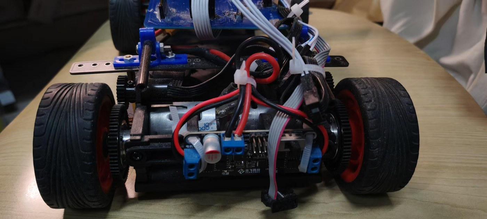
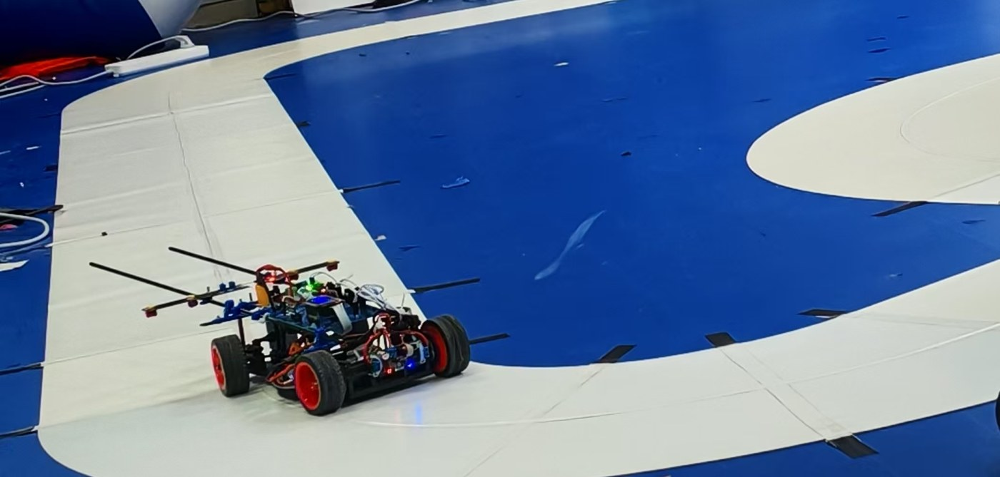
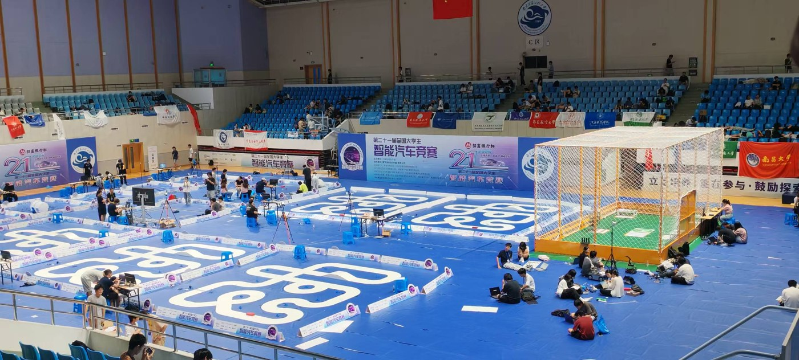
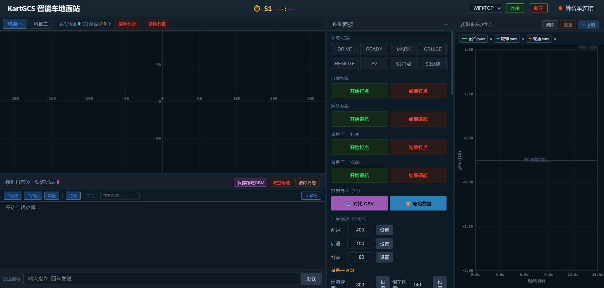
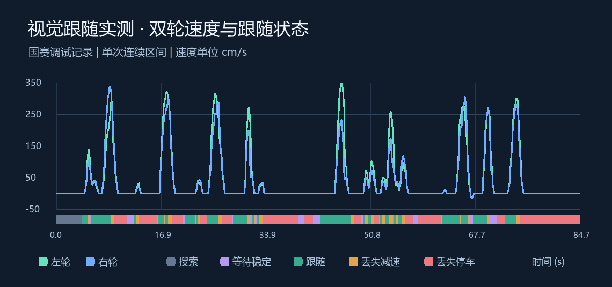

[← 返回作品集首页](../../README.md)

# 卡丁快跑｜全国大学生智能汽车竞赛

**华东赛区一等奖 · 全国赛区一等奖**

2025.09–2026.09 · C / AURIX TC377 / 逐飞库 / Python / FastAPI / WebSocket

## 比赛与实车演示

| 校赛阶段 | 国赛阶段 |
| --- | --- |
|  |  |

[观看国赛阶段实车跑测（MP4，约 41 秒）](media/national-track.mp4)

华东赛区完成路径打点与复现、语音指令动作、遥控驶至终点后自主返航。全国赛区改为通过视觉识别人员身上的色块，跟随至终点并记录行驶路径，再自主返回起点。

## 个人负责

- **车端控制**：基于 TC377 和逐飞库编写控制程序，融合 IMU 与双轮编码器进行定位，通过追踪算法复现打点路径。国赛加入视觉跟随状态机，按设定距离跟随色块并同步记录路径。
- **网页地面站**：开发轨迹显示、控制参数下发、运行数据记录及 CSV 导出功能，用于实车测试和参数调试。

## 网页地面站

[查看地面站前端源码](ground-station/index.html) · 实车连接和实时数据依赖本地 FastAPI 后端与 WebSocket。

## 遥测案例 · 色块丢失后的减速与停车

从实车日志截取约 **84.7 秒、1,152 条**连续记录，时间以该段首条记录为零点。上方两条曲线分别是左右轮实测速度，下方色带标记跟随状态。联调时可以把「丢失减速」「丢失停车」的切换与速度曲线对照，检查车端的响应。

[查看样例 CSV](data/follow-sample.csv) · [字段说明](data/README.md)
